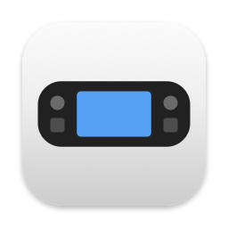
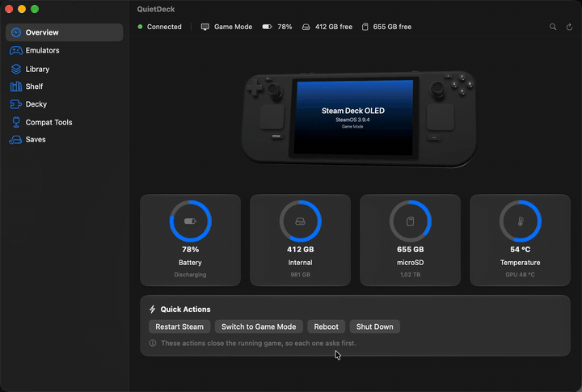
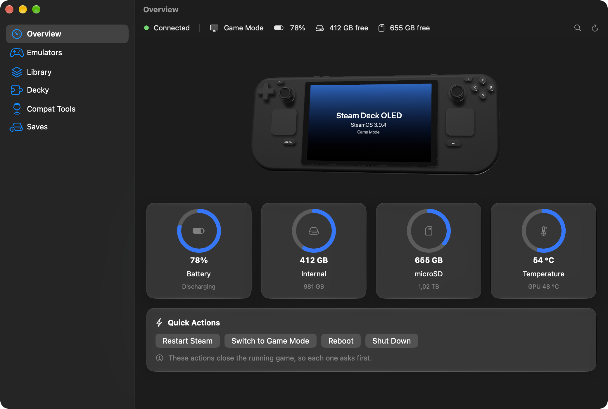
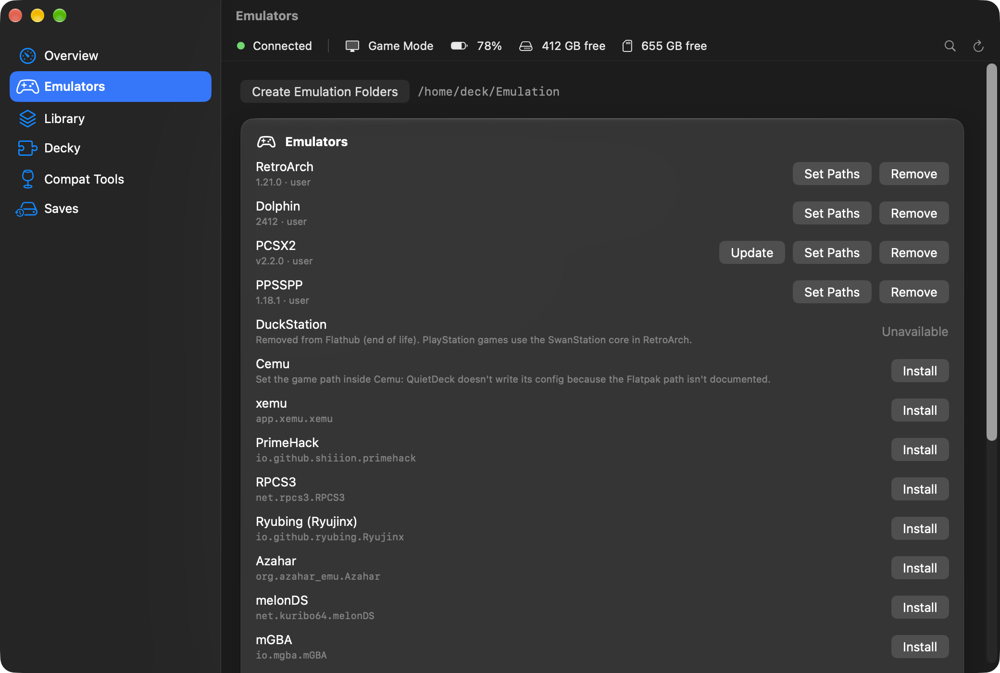
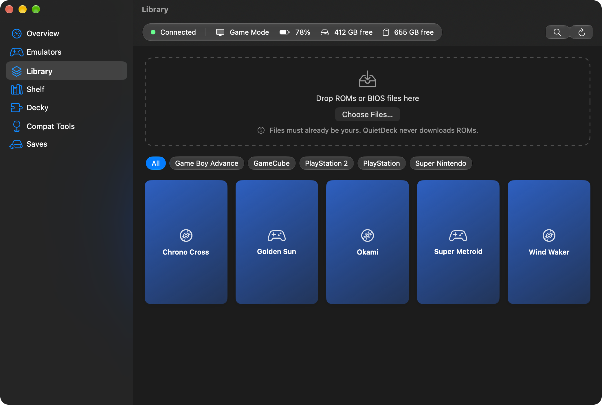
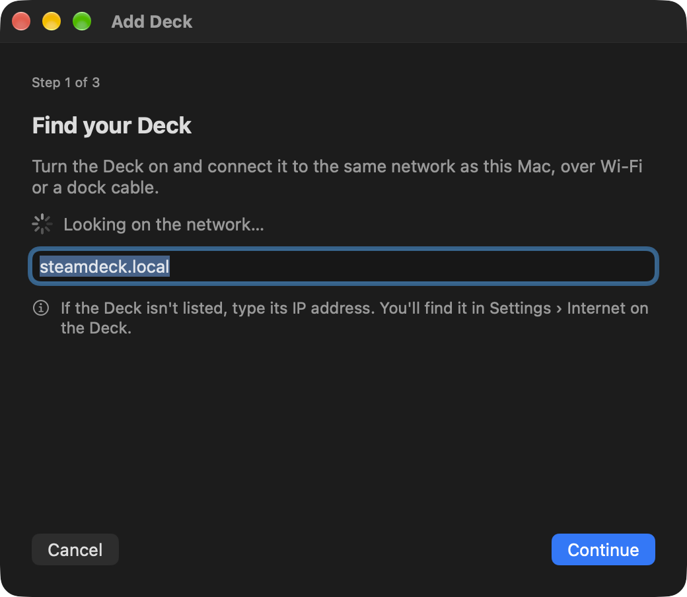
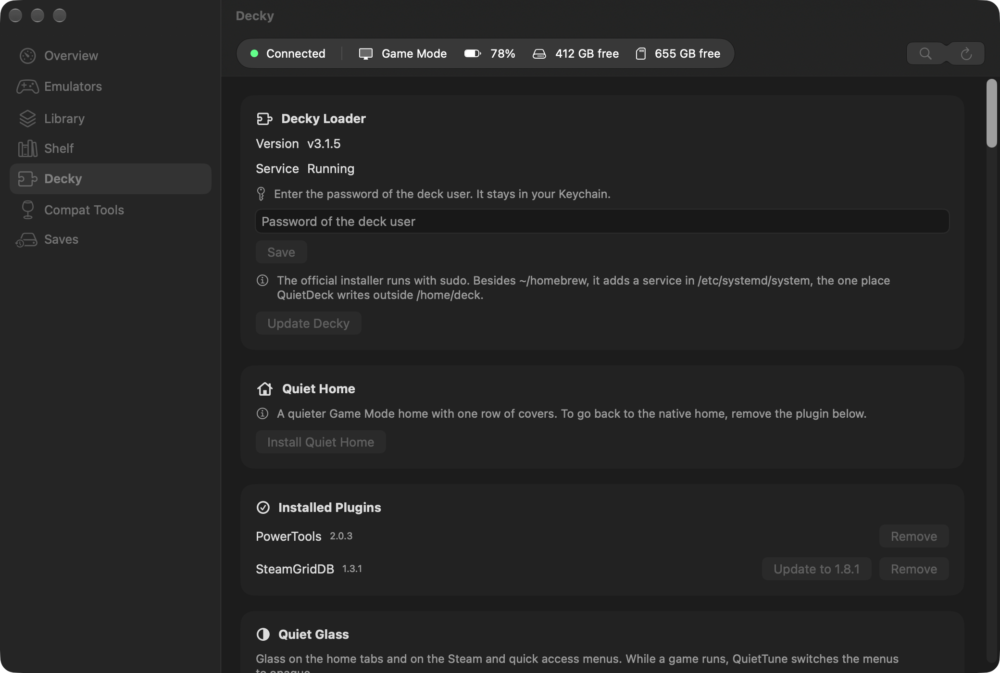
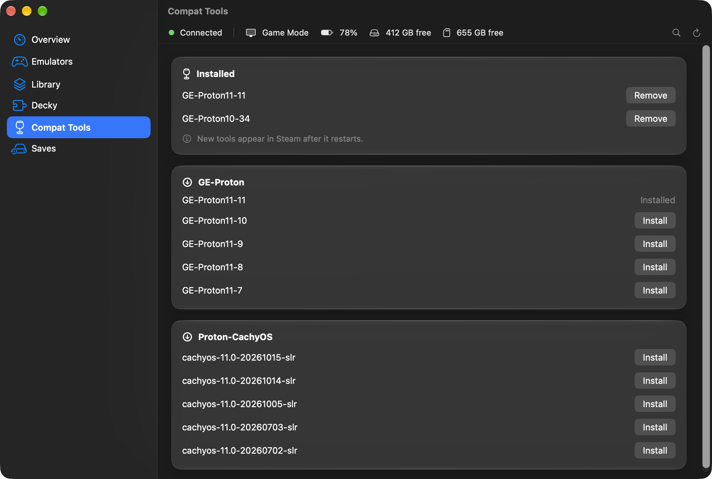

<p align="center"></p>

<h1 align="center">QuietDeck</h1>

<p align="center">
Manage your Steam Deck from your Mac over the local network, without going into Desktop Mode.
</p>

<p align="center">
<a href="https://github.com/raphaeltorquat0/QuietDeck/releases/latest"><b>⬇︎ Download the latest version (.dmg)</b></a>
</p>

<p align="center">

</p>

QuietDeck is a native Swift/SwiftUI app that talks to your Deck with the Mac's own `ssh` and `rsync`. You pair it once from the Deck's Settings, with no keyboard and no Desktop Mode, and everything else happens from the Mac, over Wi-Fi or a dock cable.

> Independent project. **Not affiliated with, endorsed by or supported by Valve.** "Steam" and "Steam Deck" are trademarks of Valve Corporation, used only to indicate compatibility.

> **Early release.** QuietDeck 0.1.0 is tested against a simulated Deck in Docker and, in part, on a Steam Deck LCD with SteamOS 3.9.5, including pairing, shortcuts in Game Mode and Quiet Home. [SMOKE_TEST.md](SMOKE_TEST.md) lists what has been checked on real hardware and what hasn't.

## Features

- **Overview:** SteamOS version, battery, internal and microSD storage, temperature, and Game or Desktop Mode, plus quick actions
- **Emulators:** install, update and remove RetroArch, Dolphin, PCSX2, PPSSPP, Cemu, xemu, PrimeHack and more as user Flatpaks. The experimental Switch 2 emulator [Lichii](https://github.com/zortos293/Lichii) (GPL-3.0) is installed from the [Steam Deck build](https://github.com/raphaeltorquat0/Lichii/releases): each upstream release recompiled for the Deck's CPU with the upstream PGO profile and a few Deck patches (`deck/patches/`), published with its SHA-256, which is checked before installing. The previous version is kept for rollback and the saves live in a folder of their own. Games go in a folder named `switch2`
- **Folders:** creates `~/Emulation` in the EmuDeck/ES-DE layout, and follows EmuDeck when it's already installed
- **BIOS:** status per system, with imports checked against known hashes
- **Library:** drop your own ROMs. QuietDeck detects the system, extracts archives, decompresses Switch `.nsz` and `.xcz` with your own `prod.keys`, installs your own Switch firmware dropped as a folder or `.zip`, installs Switch translations and mods in LayeredFS format, applies translation patches (`.ips`, `.ups`, `.bps`, `.xdelta`) dropped with the ROM, sends extracted PS4 game folders for shadPS4, signs RetroArch and Dolphin in to RetroAchievements with your account, converts disc images to CHD, creates `.m3u` playlists, skips duplicates by hash and resumes interrupted transfers
- **Steam shortcuts:** sending a game adds it to Steam and to the top of Quiet Home, waiting for any open game to close first. Adds non-Steam games to `shortcuts.vdf` with a backup, and fetches artwork from SteamGridDB with your API key
- **Decky Loader:** install the loader and browse the plugin store
- **Compat tools:** install and remove GE-Proton and Proton-CachyOS
- **Saves:** back up to and restore from a folder on your Mac
- **Queue:** transfers and installs keep going in the background and survive closing the app
- **Quiet Home:** a calmer Game Mode home with one row of covers, playtime and achievements, installed as a Decky plugin
- **Command palette:** ⌘K finds every action, game, emulator and plugin
- **Menu bar:** optional status, battery and update count
- Several Decks, light and dark mode, English and Brazilian Portuguese

QuietDeck never downloads ROMs, BIOS or firmware, and never turns off SteamOS's read-only system.

| | |
|---|---|
|  |  |
|  |  |
|  |  |

The screenshots use sample data, not a real library.

### Shelf

A storefront for the collection you already own. Add as many sources as you like, each with its own priority: a folder or external disk, SMB, NFS, SFTP/SSH, WebDAV, an S3-compatible bucket (Backblaze B2, MinIO, Cloudflare R2), a RomM server or an [optional container service](Service/shelf/README.md). Tailscale addresses work too.

- Browse by cover, filter and search, and check your files against the No-Intro or Redump DATs you supply.
- Install or remove in one click, with the Steam shortcut and artwork. Direct server → Deck transfers skip the Mac when nothing needs processing.
- Get descriptions and artwork from ScreenScraper or IGDB with your own credentials.
- Try **Free and Legal**, a catalog of homebrew with verified licenses ([rules](CATALOG.md)), and read the Stocking Guide.

Sources are always your own servers. QuietDeck never searches for, indexes or downloads commercial games from the internet, and it has no repositories, remote catalogs, suggested servers or collection sharing.

## Install

**Homebrew:**

```sh
brew install --cask raphaeltorquat0/tap/quietdeck
```

**Download:** get `QuietDeck-<version>.dmg` from [Releases](https://github.com/raphaeltorquat0/QuietDeck/releases/latest) and drag QuietDeck to **Applications**.

Either way, macOS blocks the first launch because the app isn't notarized by Apple yet:

1. Try to open QuietDeck. Close the warning with **OK** or **Done**, not **Move to Trash**.
2. Go to **System Settings › Privacy & Security** and scroll to **Security**.
3. Click **Open Anyway** next to QuietDeck and confirm with your password.

Allow **Local Network** access when macOS asks.

QuietDeck runs on macOS 26 or later, on Apple Silicon and Intel. Converting games to CHD uses `chdman`, which QuietDeck installs through Homebrew the first time it's needed. Compressed Switch games use `nsz`, installed the same way through `pipx`, and `.xdelta` patches use `xdelta3`, from Homebrew.

### Build from source

```sh
git clone https://github.com/raphaeltorquat0/QuietDeck.git && cd QuietDeck
make install
```

Requires Xcode 26 or later and [XcodeGen](https://github.com/yonaskolb/XcodeGen).

## Set up your Deck

The app walks you through it once:

1. On the Deck, go to **Settings › System** and turn on **Enable Developer Mode**.
2. Go to **Settings › Developer › Pair new host**.
3. Approve the request from your Mac on the Deck's screen.

The wizard moves on by itself at each step. Developer Mode exposes Steam's debug port on your local network, so turn it off if you don't trust the network.

QuietDeck creates its own key at `~/.ssh/quietdeck_devkit_rsa` and logs in with it. It asks for the `deck` password only when an action needs `sudo`, like installing Decky, and offers to set one from the Mac if there isn't one yet. The password stays in your Keychain.

If pairing doesn't work, the wizard shows a manual path through Desktop Mode.

## Where it writes on the Deck

Everything goes in `/home/deck` or on the microSD, with three exceptions:

- The official Decky installer adds a service in `/etc/systemd/system`. The app tells you before it runs.
- Saving shortcuts briefly masks `steam-launcher.service` in temporary runtime storage, so Steam can't restart mid-write. The mask disappears when it's done, or on reboot.
- Developer Mode and pairing are done by Valve's own service, which turns on SSH.

Actions that close the running game, like saving shortcuts or restarting Steam, always ask first.

## For developers

- [`CONTRIBUTING.md`](CONTRIBUTING.md): setup and how the project fits together
- [`DECISIONS.md`](DECISIONS.md): design decisions and sources, in Portuguese
- [`SMOKE_TEST.md`](SMOKE_TEST.md): manual checks on a real Deck

## Support

If QuietDeck saves you a trip to Desktop Mode, you can [buy me a coffee](https://buymeacoffee.com/raphaeltorquato).

## License

[MIT](LICENSE) © Raphael Torquato
