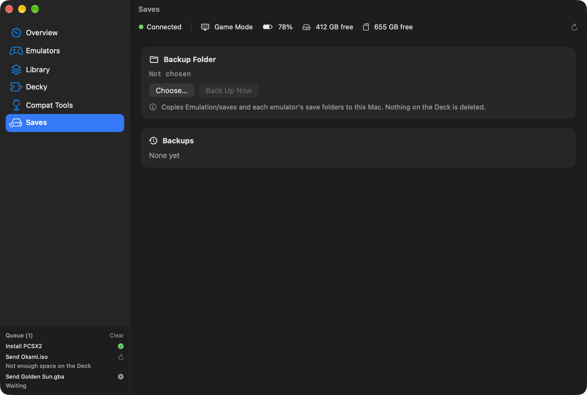

<p align="center"></p>

<h1 align="center">QuietDeck</h1>

<p align="center">
Manage your Steam Deck from your Mac over the local network, without going into Desktop Mode.
</p>

<p align="center">
<a href="https://github.com/raphaeltorquat0/QuietDeck/releases/latest"><b>⬇︎ Download the latest version (.dmg)</b></a>
</p>

<p align="center">

</p>

QuietDeck is a native Swift/SwiftUI app that talks to your Deck with the Mac's own `ssh` and `rsync`. After a one-time setup in Desktop Mode, everything happens from the Mac, over Wi-Fi or a dock cable.

> Independent project. **Not affiliated with, endorsed by or supported by Valve.** "Steam" and "Steam Deck" are trademarks of Valve Corporation, used only to indicate compatibility.

> **Early release.** QuietDeck 0.1.0 is tested against a simulated Deck in Docker. See [SMOKE_TEST.md](SMOKE_TEST.md) for the real-hardware checklist.

## Features

- **Overview:** SteamOS version, battery, internal and microSD storage, temperature, and Game or Desktop Mode, plus quick actions
- **Emulators:** install, update and remove RetroArch, Dolphin, PCSX2, PPSSPP, Cemu, xemu, PrimeHack and more as user Flatpaks
- **Folders:** creates `~/Emulation` in the EmuDeck/ES-DE layout, and follows EmuDeck when it's already installed
- **BIOS:** status per system, with imports checked against known hashes
- **Library:** drop your own ROMs. QuietDeck detects the system, extracts archives, converts disc images to CHD, creates `.m3u` playlists, skips duplicates by hash and resumes interrupted transfers
- **Steam shortcuts:** adds non-Steam games to `shortcuts.vdf` with a backup, and fetches artwork from SteamGridDB with your API key
- **Decky Loader:** install the loader and browse the plugin store
- **Compat tools:** install and remove GE-Proton and Proton-CachyOS
- **Saves:** back up to and restore from a folder on your Mac
- **Queue:** transfers and installs keep going in the background and survive closing the app
- **Menu bar:** optional status, battery and update count
- Several Decks, light and dark mode, keyboard shortcuts

QuietDeck never downloads ROMs, BIOS or firmware, and never turns off SteamOS's read-only system.

| | |
|---|---|
|  |  |
|  |  |
|  |  |

The screenshots use sample data, not a real library.

## Install

**Homebrew:**

```sh
brew install --cask raphaeltorquat0/tap/quietdeck
```

**Download:** get `QuietDeck-<version>.dmg` from [Releases](https://github.com/raphaeltorquat0/QuietDeck/releases/latest) and drag QuietDeck to **Applications**.

Either way, macOS blocks the first launch because the app isn't notarized by Apple yet:

1. Try to open QuietDeck. Close the warning with **OK** or **Done**, not **Move to Trash**.
2. Go to **System Settings › Privacy & Security** and scroll to **Security**.
3. Click **Open Anyway** next to QuietDeck and confirm with your password.

Allow **Local Network** access when macOS asks.

QuietDeck runs on macOS 14 or later, on Apple Silicon and Intel. Converting games to CHD uses `chdman`, which QuietDeck installs through Homebrew the first time it's needed.

### Build from source

```sh
git clone https://github.com/raphaeltorquat0/QuietDeck.git && cd QuietDeck
make install
```

Requires Xcode 26 or later and [XcodeGen](https://github.com/yonaskolb/XcodeGen).

## Set up your Deck

You only do this once. The app walks you through it:

1. On the Deck, switch to Desktop Mode and open **Konsole**.
2. Set a password, if you don't have one, with `passwd`.
3. Turn on SSH with `sudo systemctl enable --now sshd`.
4. In QuietDeck, pick your Deck and enter the password.

QuietDeck then creates its own key at `~/.ssh/quietdeck_ed25519` and logs in with it. The password stays in your Keychain and is only used for actions that need `sudo`.

## Where it writes on the Deck

Everything goes in `/home/deck` or on the microSD, with two exceptions:

- The official Decky installer adds a service in `/etc/systemd/system`. The app tells you before it runs.
- Saving shortcuts briefly masks `steam-launcher.service` in temporary runtime storage, so Steam can't restart mid-write. The mask disappears when it's done, or on reboot.

Actions that close the running game, like saving shortcuts or restarting Steam, always ask first.

## For developers

- [`CONTRIBUTING.md`](CONTRIBUTING.md): setup and how the project fits together
- [`DECISIONS.md`](DECISIONS.md): design decisions and sources, in Portuguese
- [`SMOKE_TEST.md`](SMOKE_TEST.md): manual checks on a real Deck

## Support

If QuietDeck saves you a trip to Desktop Mode, you can [buy me a coffee](https://buymeacoffee.com/raphaeltorquato).

## License

[MIT](LICENSE) © Raphael Torquato
